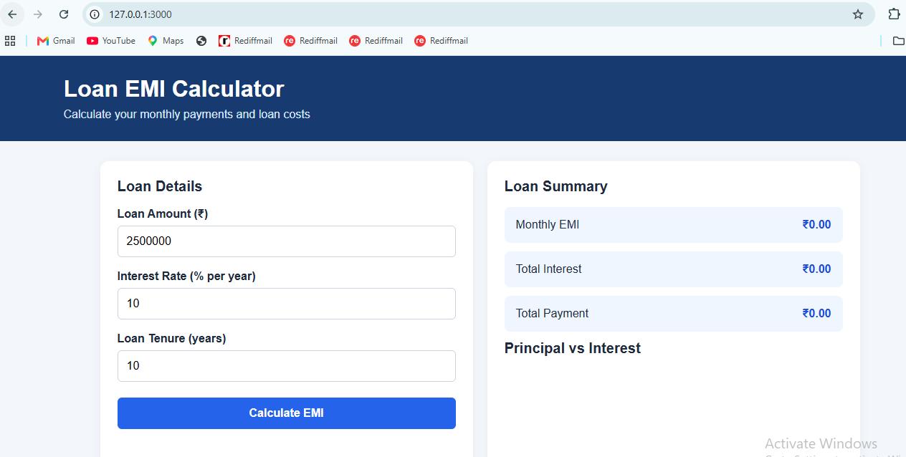
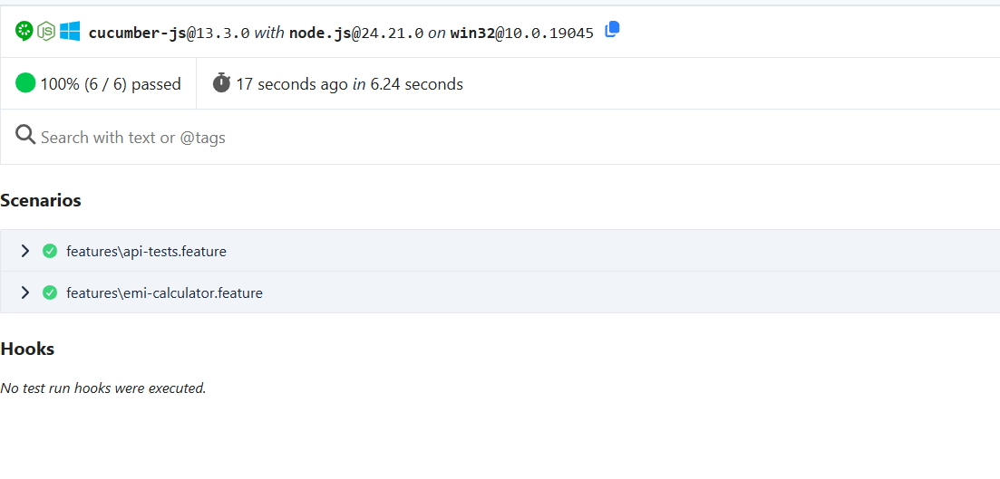
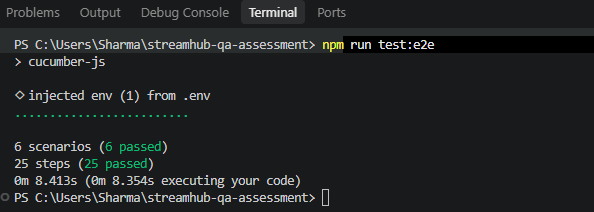

# Streamhub QA Automation Assessment

## Project Overview

This project demonstrates a web application, UI automation, API testing, SQL validation, and an AI-assisted locator self-healing approach.

The application is an interactive **Loan EMI Calculator** that allows users to enter loan details and view the calculated monthly EMI, total interest, total payment, and a principal-versus-interest chart.

### Key Highlights

- Built an interactive EMI Calculator web application.
- Created a BDD test framework using Playwright and Cucumber.
- Used the Page Object Model (POM) for maintainable UI automation.
- Validated EMI calculations against independently calculated expected values.
- Verified chart visibility and non-zero chart data.
- Automated API scenarios against JSONPlaceholder.
- Implemented SQL queries for round-trip transactions and consecutive scoring streaks.
- Documented an AI-assisted approach for identifying and repairing brittle locators.
- Included UI, Cucumber report, terminal, and SQL evidence.

## Technology Stack

- **Frontend:** HTML, CSS, JavaScript
- **UI and API Automation:** Playwright
- **BDD Framework:** Cucumber
- **Programming Language:** JavaScript
- **API Testing:** JSONPlaceholder
- **Database Queries:** SQLite-compatible SQL
- **Configuration:** dotenv
- **Version Control:** Git and GitHub

## Project Structure

```text
streamhub-qa-assessment/
├── src/
│   ├── index.html
│   ├── style.css
│   └── app.js
├── features/
│   ├── emi-calculator.feature
│   ├── api-tests.feature
│   └── step-definitions/
│       ├── emi-steps.js
│       └── api-steps.js
├── pages/
│   └── EmiCalculatorPage.js
├── support/
│   ├── world.js
│   └── hooks.js
├── tests/
│   └── broken-locators.example.js
├── tests/sql/
│   ├── round-trip-transactions.sql
│   └── ipl-scoring-streaks.sql
├── docs/
│   └── ai-self-healing.md
├── evidence/
│   ├── emi-calculator-ui.png
│   ├── cucumber-test-results.png
│   ├── test-execution-terminal.png
│   ├── transaction-table.png
│   ├── round-trip-query.png
│   ├── ipl-table.png
│   └── ipl-streak-query.png
├── reports/
│   └── cucumber-report.html
├── .env
├── .gitignore
├── cucumber.js
├── package.json
└── README.md
```

## Prerequisites

- Node.js and npm
- Git
- Chromium installed through Playwright

## Setup Instructions

### 1. Clone the repository

```bash
git clone https://github.com/ramchandras/streamhub-qa-assessment.git
cd streamhub-qa-assessment
```

### 2. Install dependencies

```bash
npm install
```

### 3. Install the Playwright browser

```bash
npx playwright install chromium
```

### 4. Configure the environment

Create a `.env` file in the project root:

```env
BASE_URL=http://localhost:3000
```

The environment configuration keeps the application URL separate from the test code. Do not commit secrets or private credentials.

### 5. Start the application

Run this command from the project root:

```bash
npx http-server src -p 3000
```

If prompted to install `http-server`, approve the installation.

Open the application at [http://localhost:3000](http://localhost:3000). Keep the server running while executing the UI tests.

## Running the Tests

Open a second terminal in the project directory and run:

```bash
npm run test:e2e
```

The Cucumber HTML report is generated at:

```text
reports/cucumber-report.html
```

To open the report locally on Windows:

```powershell
start .\reports\cucumber-report.html
```

## Test Coverage

### 1. EMI Calculator UI Tests

The EMI Calculator tests validate the application workflow, independently calculate expected EMI values, and verify chart data.

| Scenario | Loan Amount | Interest Rate | Tenure |
|---|---:|---:|---:|
| Scenario A | ₹25,00,000 | 10% | 10 years |
| Scenario B | ₹50,00,000 | 7.5% | 15 years |

The tests validate:

- Application loading and navigation.
- Loan input and EMI calculation.
- Comparison against independently calculated EMI.
- Chart visibility.
- Positive principal and interest values represented by the chart.

### 2. API Tests

The API tests target:

`POST https://jsonplaceholder.typicode.com/posts`

Scenarios cover:

- Creating a post with valid data.
- Submitting an excessively long title.
- Submitting special characters.
- Omitting the `userId` field.

**Note:** JSONPlaceholder is a mock API. It may accept invalid-looking payloads instead of enforcing production-style validation. The tests check the observed response and ensure the API does not return a server-error status; they do not assume every invalid payload must be rejected.

### 3. SQL Tests

Two SQL challenges are included.

**Round-trip transactions**  
Identifies reverse transactions between two accounts where the amounts differ by no more than 10% and both transactions occur within a 24-hour window.

File: `tests/sql/round-trip-transactions.sql`

**IPL scoring streaks**  
Identifies players scoring at least 30 runs in three or more consecutive matches and returns the date on which each qualifying streak began.

File: `tests/sql/ipl-scoring-streaks.sql`

The IPL-style records are illustrative sample data and should not be interpreted as verified historical IPL statistics.

SQL table and query-output screenshots are linked in the evidence section below.

## UI Test Evidence

### EMI Calculator UI

The screenshot shows the EMI Calculator interface with loan inputs and the loan summary.



### Cucumber Test Results

The Cucumber report screenshot shows **100% pass rate (6 of 6 scenarios passed)**.



### Test Execution Terminal

The terminal screenshot shows the test command and successful execution output.



### SQL Evidence

- [Transaction Table](evidence/transaction-table.png)
- [Round-trip Transaction Query Output](evidence/round-trip-query.png)
- [IPL Sample Data Table](evidence/ipl-table.png)
- [IPL Scoring Streak Query Output](evidence/ipl-streak-query.png)

## Latest Test Results

The latest reported local terminal run completed successfully.

| Metric | Result |
|---|---:|
| Scenarios passed | 6 |
| Steps passed | 25 |
| Failed scenarios | 0 |
| Failed steps | 0 |

The Cucumber HTML report screenshot separately shows a 100% pass rate across 6 scenarios. Run the tests again after code changes to regenerate the report and confirm the current result.

## AI-Assisted Locator Self-Healing

The project includes deliberately incorrect or brittle locator examples for the self-healing exercise. They are kept separate from the regular passing test flow.

The examples demonstrate potential problems such as:

- Incorrect test IDs.
- Incorrect accessible names.
- Positional CSS selectors.
- Generated CSS class names.
- Overly broad text selectors.

Proposed self-healing workflow:

1. Detect the locator failure and capture the error, page state, and relevant DOM information.
2. Ask an AI tool to identify the likely cause and suggest a more resilient locator.
3. Prefer accessible roles, labels, and stable test IDs.
4. Review the suggested locator against the actual application.
5. Run the affected test and relevant regression tests before accepting the change.

Detailed documentation: [`docs/ai-self-healing.md`](docs/ai-self-healing.md).

## AI Tool Reflection

AI-assisted development was used as a pair-programming aid during the assessment.

**What worked well**

- Structuring the project into feature files, step definitions, page objects, and support files.
- Explaining Cucumber and Playwright APIs.
- Supporting test scenario development and SQL query reasoning.
- Identifying potential locator weaknesses and improving documentation.

**What required validation**

- Generated selectors and API assumptions needed to be checked against the actual application and API behaviour.
- Test expectations needed to match the behaviour of the mock API.
- SQL queries needed to be checked against sample data and the intended business rules.
- Execution results and manual review were used to validate the implementation instead of relying on generated code alone.

AI was used to accelerate development and troubleshooting, while test execution and review were used to validate the implementation.

## Repository

GitHub: https://github.com/ramchandras/streamhub-qa-assessment

---

**Assessment:** Streamhub QA Automation Assessment  
**Framework:** Playwright + Cucumber  
**Application:** Loan EMI Calculator  
**Evidence:** UI screenshots, Cucumber report screenshot, terminal output, HTML report, and SQL query outputs
